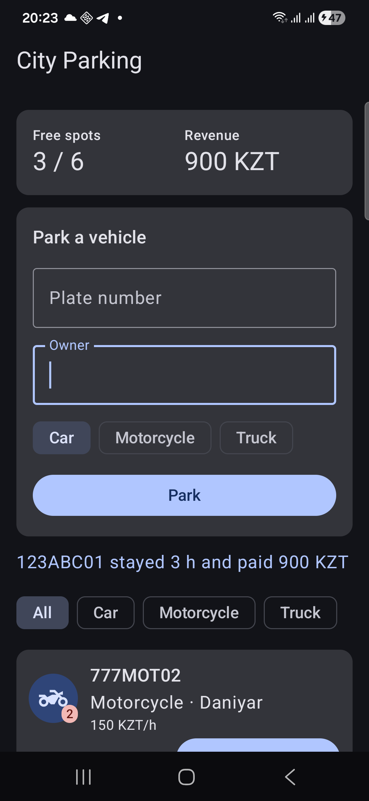
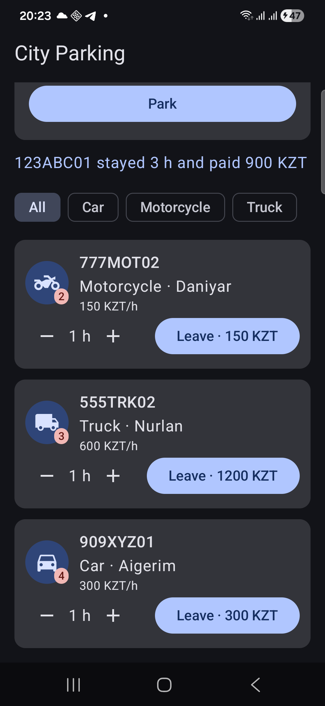
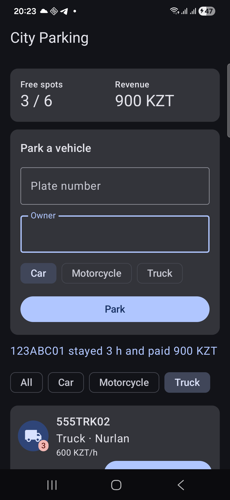
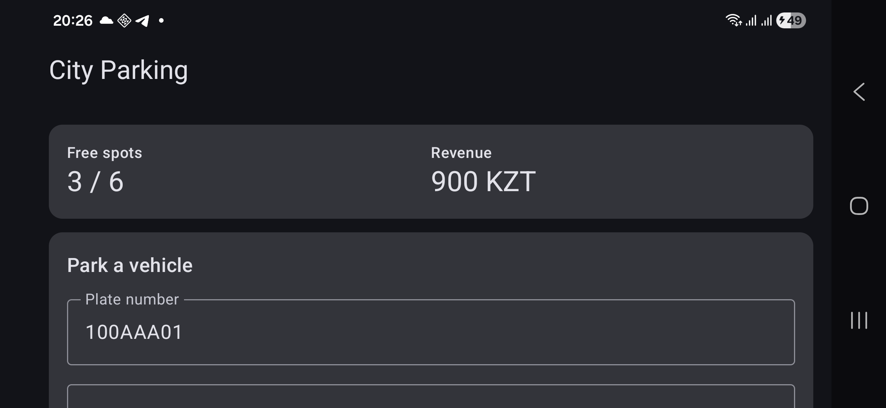

# Parking Lot

A city parking lot app built in two steps:

- **Task 2:** Android app with Jetpack Compose, in [`android/`](android)
- **Task 1:** Kotlin console app, in the repository root (`src/`)

The Android app reuses the Task 1 classes (`Vehicle`, `ParkingLot`, `ParkingResult`, `ParkingRecord`).

---

## Task 2: Android app

An app for a parking lot attendant. It shows how many spots are free and how much the lot has earned, lets the attendant park new vehicles, and charges vehicles when they leave. The fee depends on the vehicle type: cars pay 300 KZT/h, motorcycles 150 KZT/h, and trucks 600 KZT/h with a 2-hour minimum.

### Features

- **Free spots and revenue** at the top, updated after every action
- **Park a vehicle:** enter a plate and an owner, pick the type, tap Park. The app shows the spot and ticket number, or explains why parking failed (lot full, already parked, empty fields)
- **Leave and pay:** choose the hours on a vehicle's card. The button shows the fee before you tap it
- **Fee details:** tap a card to see what the vehicle would pay for 1–4 hours
- **Filter** the parked vehicles by type

### How to run

1. Open the `android` folder in Android Studio.
2. Wait for the Gradle sync to finish.
3. Connect an Android phone with USB debugging enabled (Android 8.0 or newer), or start an emulator.
4. Press **Run ▶**.

### Screenshots

  

From left to right: the main screen after a vehicle left and paid; the list of parked vehicles; the "Truck" filter.



After rotation: the typed plate (`rememberSaveable`) and the revenue and free spots (`ViewModel`) are kept.

### Requirements

- Architecture: `model/` (logic from Task 1), `ParkingViewModel` (state), `ParkingScreen.kt` and `Components.kt` (UI)
- Reusable composables: `StatsHeader`, `StatItem`, `ChipSelector`, `ParkForm`, `VehicleCard`, `VehicleIcon`
- Row/Column/Box, Card, Image: `Components.kt`; LazyColumn: `ParkingScreen.kt`
- Inputs: text fields and chips in `ParkForm`, buttons on each card
- ViewModel: `StateFlow<ParkingUiState>` collected with `collectAsStateWithLifecycle()`

### State on rotation

- `remember`: fee details on a card collapse after rotation
- `rememberSaveable`: text in the Park form stays
- `ViewModel`: parked vehicles, revenue, filter and selected hours stay

---

## Task 1: Console app

A small Kotlin console application that simulates a city parking lot. Vehicles arrive, an entrance camera scans their plates, they park in free spots, and when they leave they pay a fee that depends on the vehicle type. At the end the program prints revenue and other statistics.

### How to run

Requirements: JDK 17 or newer.

**IntelliJ IDEA:** open the project folder (it is imported as a Gradle project), then run `main()` in `src/main/kotlin/Main.kt`.

**Command line:**

```bash
./gradlew run
```

On Windows use `gradlew.bat run`.

### Where the requirements are demonstrated

- **Variables, data types, conditions, loops:** throughout `Main.kt`; `while` loop in `ParkingLot.park()`
- **List, Set, Map:** `arriving` (List), `typesServed` (Set), `stays` (Map) in `Main.kt`
- **map, filter, reduce:** `ParkingLot.totalRevenue()` and the statistics in `Main.kt`
- **Higher-order functions and lambdas:** `ParkingLot.findVehicles { ... }`
- **Classes and objects:** `ParkingLot` class; `TicketCounter` object
- **Inheritance:** `Car`, `Motorcycle`, `Truck` extend `Vehicle`
- **Interfaces and polymorphism:** `Billable` interface; the parking fee depends on the vehicle type
- **Data class:** `ParkingRecord`
- **Sealed class:** `ParkingResult`, handled with `when` in `Main.kt`
- **Suspend function and coroutine:** `scanPlate()`, launched for every vehicle in `main()`
